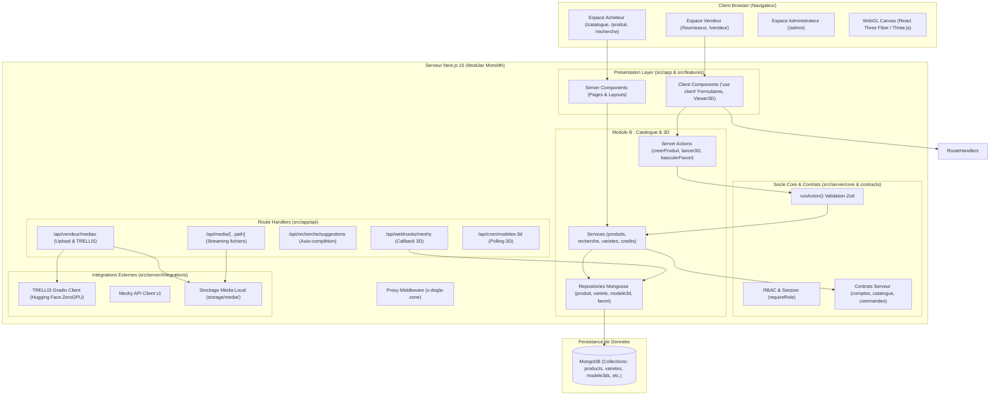
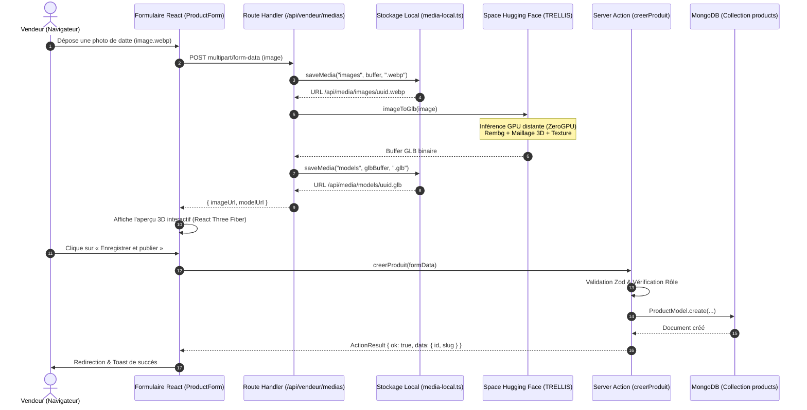
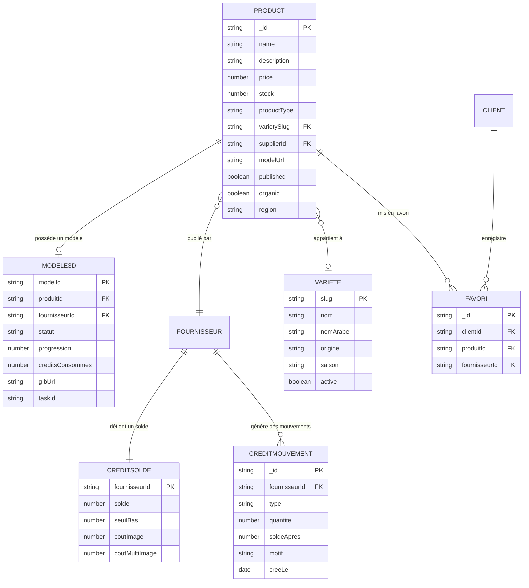
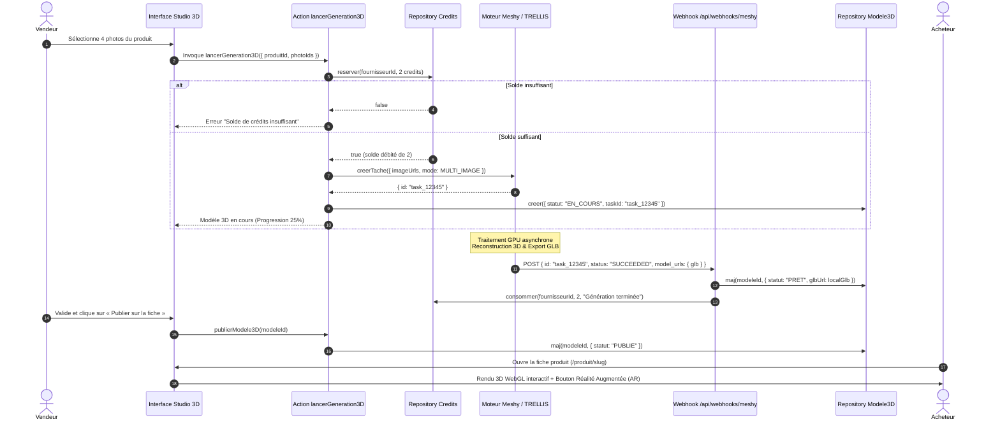

# DEGLA — Plateforme E-Commerce de Dattes Tunisiennes & Modélisation 3D

> **Projet de Validation Universitaire**  
> **Application :** Marketplace mobile-first de dattes d'excellence et produits dérivés de terroirs tunisiens (Tozeur, Kébili, Gabès).  
> **Auteur du Module B (Catalogue, Produits, 3D & IA) :** Ali Belkathi  
> **Stack Principale :** Next.js 16 (App Router, Server Actions, Turbopack), React 19, TypeScript 5, MongoDB / Mongoose, React Three Fiber / Three.js, TRELLIS (Hugging Face) & Meshy API, Tailwind CSS v4, Zustand, Zod.

---

## Sommaire

1. [Présentation Générale](#1-présentation-générale)
   - [Problématique & Contexte](#problématique--contexte)
   - [Objectifs du Projet](#objectifs-du-projet)
   - [Périmètre des Trois Espaces](#périmètre-des-trois-espaces)
   - [Focus sur le Module B (Catalogue, Produits & 3D)](#focus-sur-le-module-b-catalogue-produits--3d)
2. [Architecture Globale du Projet](#2-architecture-globale-du-projet)
   - [Le Patron Modular Monolith](#le-patron-modular-monolith)
   - [Communication Inter-Modules & Contrats Serveur](#communication-inter-modules--contrats-serveur)
   - [Diagramme d'Architecture Globale (Mermaid)](#diagramme-darchitecture-globale-mermaid)
3. [Architecture en Couches (Layered Architecture)](#3-architecture-en-couches-layered-architecture)
   - [Presentation Layer (Couche Présentation)](#presentation-layer-couche-présentation)
   - [Application Layer (Couche Application)](#application-layer-couche-application)
   - [Domain Layer (Couche Domaine)](#domain-layer-couche-domaine)
   - [Infrastructure Layer (Couche Infrastructure)](#infrastructure-layer-couche-infrastructure)
   - [Traversée d'une Requête (Exemple Concret)](#traversée-dune-requête-exemple-concret)
4. [Arborescence Réelle du Répertoire & Rôle des Fichiers](#4-arborescence-réelle-du-répertoire--rôle-des-fichiers)
   - [Arborescence Globale](#arborescence-globale)
   - [Inventaire et Responsabilités des Fichiers Clés](#inventaire-et-responsabilités-des-fichiers-clés)
5. [Frontend — Parcours Utilisateur & Écrans Réalisés](#5-frontend--parcours-utilisateur--écrans-réalisés)
   - [Interface Acheteur (Client — 6 écrans)](#interface-acheteur-client--6-écrans)
   - [Interface Vendeur / Fournisseur (5 écrans)](#interface-vendeur--fournisseur-5-écrans)
   - [Interface Administrateur (3 écrans)](#interface-administrateur-3-écrans)
6. [Backend — Logique Métier, Services & Server Actions](#6-backend--logique-métier-services--server-actions)
   - [Server Actions (Mutations Sécurisées)](#server-actions-mutations-sécurisées)
   - [Services Métier](#services-métier)
   - [Gestion Uniforme des Erreurs et ActionResult](#gestion-uniforme-des-erreurs-et-actionresult)
7. [Documentation Complète des API (REST & Route Handlers)](#7-documentation-complète-des-api-rest--route-handlers)
   - [Tableau Récapitulatif des Endpoints](#tableau-récapitulatif-des-endpoints)
   - [Détail des Routes Clés](#détail-des-routes-clés)
   - [Diagramme de Cycle de Requête API](#diagramme-de-cycle-de-requête-api)
8. [Base de Données — Persistance Réelle MongoDB & Schéma Prisma](#8-base-de-données--persistance-réelle-mongodb--schéma-prisma)
   - [Base Réelle : MongoDB avec Mongoose (Module B)](#base-réelle--mongodb-avec-mongoose-module-b)
   - [Modèles de Données Mongoose](#modèles-de-données-mongoose)
   - [Diagramme Entité-Relation (Mermaid)](#diagramme-entité-relation-mermaid)
   - [Préparation PostgreSQL / Prisma](#préparation-postgresql--prisma)
9. [Génération 3D, Réalité Augmentée & Intelligence Artificielle](#9-génération-3d-réalité-augmentée--intelligence-artificielle)
   - [Pipeline 1 : TRELLIS Image-to-GLB (ZeroGPU Hugging Face)](#pipeline-1--trellis-image-to-glb-zerogpu-hugging-face)
   - [Pipeline 2 : Meshy API v1 (Webhook & Cron de Secours)](#pipeline-2--meshy-api-v1-webhook--cron-de-secours)
   - [Rendu 3D Client : React Three Fiber & ModelSource](#rendu-3d-client--react-three-fiber--modelsource)
   - [Réalité Augmentée (AR Web Mobile)](#réalité-augmentée-ar-web-mobile)
   - [IA-B : Rédaction Assistée de la Fiche Produit](#ia-b--rédaction-assistée-de-la-fiche-produit)
   - [Diagramme de Séquence de Génération 3D (Mermaid)](#diagramme-de-séquence-de-génération-3d-mermaid)
10. [Composants Partagés & Design System « Oasis Contemporaine »](#10-composants-partagés--design-system--oasis-contemporaine-)
    - [Charte Graphique et Tokens CSS](#charte-graphique-et-tokens-css)
    - [Composants UI Clés](#composants-ui-clés)
11. [Scénarios Complets de Fonctionnement (End-to-End)](#11-scénarios-complets-de-fonctionnement-end-to-end)
    - [Scénario A : Ajout et Publication d'un Produit par le Fournisseur](#scénario-a--ajout-et-publication-dun-produit-par-le-fournisseur)
    - [Scénario B : Modification et Mise à Jour de Stock](#scénario-b--modification-et-mise-à-jour-de-stock)
    - [Scénario C : Recherche Multi-Critères et Filtrage en Temps Réel](#scénario-c--recherche-multi-critères-et-filtrage-en-temps-réel)
    - [Scénario D : Génération 3D et Visualisation Interactive](#scénario-d--génération-3d-et-visualisation-interactive)
    - [Scénario E : Gestion du Solde et Achat de Packs de Crédits 3D](#scénario-e--gestion-du-solde-et-achat-de-packs-de-crédits-3d)
12. [Guide d'Installation, Configuration & Exécution](#12-guide-dinstallation-configuration--exécution)
    - [Prérequis Système](#prérequis-système)
    - [Variables d'Environnement (.env.local)](#variables-denvironnement-envlocal)
    - [Commandes de Démarrage et Validation](#commandes-de-démarrage-et-validation)
13. [Préparation à la Soutenance Universitaire : 18 Questions & Réponses Techniques](#13-préparation-à-la-soutenance-universitaire--18-questions--réponses-techniques)
14. [Synthèse & Bilan pour le Jury](#14-synthèse--bilan-pour-le-jury)

---

## 1. Présentation Générale

### Problématique & Contexte
La filière des dattes en Tunisie — dominée par la prestigieuse *Deglet Nour* du Djérid et du Nefzaoua, mais riche de dizaines d'autres variétés patrimoniales (*Alig, Medjool, Kenta, Khouat Alig, Bessr, Lemsi, Kentichi*) ainsi que de produits dérivés nobles (sirop/rob, pâte, confiture, café de noyaux torréfiés) — souffre d'un manque de canal direct numérique reliant les producteurs artisanaux aux consommateurs urbains et internationaux.

Les intermédiaires multiples réduisent la marge du producteur et standardisent l'offre, masquant la traçabilité des terroirs (Tozeur, Nefta, Kébili, Gabès). De plus, l'e-commerce agroalimentaire traditionnel est pénalisé par des photos plates 2D qui ne permettent pas d'apprécier la translucidité, le calibre ou la texture d'une datte.

### Objectifs du Projet
**DEGLA** est une place de marché numérique (*marketplace*) multi-vendeurs dédiée aux dattes tunisiennes et leurs dérivés, avec :
1. **Une valorisation immersive 3D/AR** : Chaque produit peut être visualisé sous tous les angles en 3D interactive (WebGL) et projeté à l'échelle réelle dans son salon ou sa cuisine via la Réalité Augmentée (AR).
2. **Une intelligence artificielle d'assistance vendeur** : Remplissage semi-automatique des fiches techniques à partir des photos de récolte et conversion 2D vers 3D.
3. **Un panier multi-vendeurs transparent** : Commande unifiée avec scission automatique par oasis/fournisseur.
4. **Une architecture robuste et modulaire** : Prévue pour évoluer à grande échelle tout en restant maintenable par une équipe d'étudiants ingénieurs.

### Périmètre des Trois Espaces

| Espace | Public Cible | Rôle & Fonctionnalités Clés |
|---|---|---|
| **Acheteur (Client)** | Consommateurs, amateurs de dattes, diaspora | Navigation catalogue, recherche instantanée (auto-suggestions), filtrage multi-critères, fiches dattes immersives avec viewer 3D & AR, gestion des favoris temps réel, panier multi-boutiques, suivi de commande. |
| **Vendeur (Fournisseur)** | Agriculteurs, coopératives oasiennes, transformateurs | Tableau de bord boutique, gestion du catalogue (CRUD complet dattes & dérivés), upload médias locaux, génération 3D (IA TRELLIS & Meshy), gestion du solde de crédits 3D, suivi des commandes entrantes. |
| **Administrateur** | Équipe de gestion de la plateforme DEGLA | Gouvernance du référentiel des 8 variétés patrimoniales, modération des catégories de produits dérivés, gestion des offres de packs de crédits 3D, supervision des litiges et vérification des vendeurs. |

### Focus sur le Module B (Catalogue, Produits & 3D)
Dans le cadre de la soutenance, le **Module B** constitue le cœur fonctionnel et technique de la plateforme :
- **Catalogue & Recherche** : Algorithme de filtrage facetté (variété, maturité, conditionnement, région, bio, 3D), auto-suggestions API temps réel.
- **Gestion Fournisseur** : Formulaire réactif avec validation stricte par Zod, distinction métier nette entre « DATTE » (prix au kilo, options de poids, maturité) et « DÉRIVÉ » (prix unitaire, contenance, ingrédients).
- **Génération & Rendu 3D** : Double pipeline IA (TRELLIS Hugging Face ZeroGPU en local/cloud + Meshy API v1 en webhook/cron), rendu WebGL fluide avec React Three Fiber sans dépendance externe bloquante, et déclencheur Web AR.
- **Persistance Réelle** : Base de données MongoDB connectée via Mongoose avec synchronisation des modèles `products`, `varietes`, `categoriederives`, `modele3ds`, `creditpacks`, `creditsoldes`, `creditmouvements` et `favoris`.

---

## 2. Architecture Globale du Projet

### Le Patron Modular Monolith
Le projet adopte l'architecture **Modular Monolith** (Monolithe Modulaire). Plutôt que de disperser l'application prématurément en microservices (ce qui introduirait une complexité réseau, des latences et des difficultés de transaction), l'ensemble de l'application est déployé dans une unique unité Next.js 16, mais **strictement découpé en domaines métiers étanches** :

- **Module A — Comptes & Authentification** (`src/features/comptes`, `src/server/modules/comptes`) : Gestion des identités, sessions, profils vendeurs, adresses, vérification de documents par IA.
- **Module B — Catalogue, Produits & 3D** (`src/features/catalogue`, `src/server/modules/catalogue`, `src/components/three`) : Catalogue public, CRUD fournisseur, studio 3D, crédits 3D, référentiels admin, viewers 3D WebGL.
- **Module C — Commandes & Ventes** (`src/features/commandes`, `src/server/modules/commandes`) : Panier, tunnel de commande multi-vendeurs, paiements, avis clients, litiges, facturation.
- **Socle Commun Transversal** (`src/components/ui`, `src/components/layout`, `src/server/core`, `src/server/contracts`) : Design system, primitives UI (shadcn/ui), gestion des rôles (RBAC), wrappers d'actions, interfaces de contrats.

### Communication Inter-Modules & Contrats Serveur
Pour préserver l'indépendance des modules et éviter les dépendances circulaires (« code spaghetti ») :
1. **Interdiction d'importation directe entre modules** : Le code interne de `server/modules/catalogue` n'importe **jamais** de fichiers privés de `server/modules/comptes` ou `server/modules/commandes`.
2. **Passage obligatoire par les contrats d'interface (`src/server/contracts/`)** :
   - `comptes.ts` : Expose au catalogue et aux commandes les méthodes `getUtilisateurCourant()`, `requireRole()`, `getFournisseur()`, `notifier()`.
   - `catalogue.ts` : Expose aux commandes les méthodes `getProduitPourPanier()`, `reserverStock()`, `libererStock()`, `rechercherProduits()`.
   - `commandes.ts` : Expose au catalogue l'initiation de paiement pour les packs de crédits 3D via `initierPaiement()`.
3. **Frontend découpé par slots et composition** : Une page peut orchestrer plusieurs features sans que les composants ne s'importent mutuellement.

### Diagramme d'Architecture Globale (Mermaid)



---

## 3. Architecture en Couches (Layered Architecture)

Au sein du module B (et de l'ensemble du projet), le code respecte les principes de la **Clean / Layered Architecture** scindée en quatre couches logicielles bien distinctes :

```text
┌─────────────────────────────────────────────────────────────┐
│ 1. PRESENTATION LAYER : UI, Pages Next.js, Formulaires, R3F │
└──────────────────────────────┬──────────────────────────────┘
                               ▼
┌─────────────────────────────────────────────────────────────┐
│ 2. APPLICATION LAYER : Server Actions, Services, Use Cases  │
└──────────────────────────────┬──────────────────────────────┘
                               ▼
┌─────────────────────────────────────────────────────────────┐
│ 3. DOMAIN LAYER : Types TypeScript, Règles Métier, Zod     │
└──────────────────────────────┬──────────────────────────────┘
                               ▼
┌─────────────────────────────────────────────────────────────┐
│ 4. INFRASTRUCTURE LAYER : Repositories Mongoose, APIs Ext.   │
└──────────────────────────────┬──────────────────────────────┘
```

### Presentation Layer (Couche Présentation)
- **Localisation** : `src/app/`, `src/features/catalogue/`, `src/components/`
- **Rôle** : Rendre l'interface, orchestrer les états d'affichage (squelettes de chargement `loading.tsx`, états d'erreur `error.tsx`, états vides `EmptyState`), capturer les interactions utilisateur et restituer le feedback visuel (toasts Sonner, modales).
- **Règle** : Les Server Components exécutent directement les lectures via les services applicatifs (pas d'appel HTTP interne inutile). Les Client Components (`"use client"`) invoquent les Server Actions via le hook réactif `useAction`.

### Application Layer (Couche Application)
- **Localisation** : `src/server/modules/catalogue/actions.ts`, `src/server/modules/catalogue/services/`
- **Rôle** : Coordonner la logique des cas d'utilisation (Use Cases). Exemples :
  - *Créer un produit* : Valider les données reçues, vérifier le rôle `FOURNISSEUR`, récupérer l'identifiant du vendeur depuis la session serveur, persister via le repository, invalider le cache Next.js (`revalidatePath`).
  - *Lancer une génération 3D* : Calculer le coût en crédits (1 crédit pour une image, 2 pour multi-angles), débiter le solde du fournisseur de manière atomique, initialiser la tâche distante, stocker l'état `EN_COURS`.
  - *Recherche globale* : Découper la chaîne de recherche, interroger en parallèle les variétés, produits et boutiques, assembler les DTOs enrichis.

### Domain Layer (Couche Domaine)
- **Localisation** : `src/types/domain.ts`, `src/types/enums.ts`, `src/lib/validation/catalogue.ts`, `src/types/model-source.ts`
- **Rôle** : Définir la vérité métier de l'application, indépendamment de toute base de données ou framework :
  - Types `ProduitDatte` et `ProduitDerive` (union discriminée sur `typeProduit`).
  - Règle des unités : Prix stockés en **millimes** entiers (1 DT = 1000 millimes) pour éliminer les erreurs d'arrondi à virgule flottante ; poids stockés en **grammes** entiers.
  - Schémas Zod partagés assurant l'intégrité à la fois dans le navigateur et sur le serveur.

### Infrastructure Layer (Couche Infrastructure)
- **Localisation** : `src/server/modules/catalogue/repositories/`, `src/server/integrations/`, `src/server/core/mongo.ts`
- **Rôle** : Réaliser les opérations concrètes vers les systèmes externes :
  - Pilote Mongoose vers MongoDB (`connectDB()`, opérations CRUD atomiques avec `$inc`, `$set`, `$exists`).
  - Système de fichiers local (`storage/media/`) avec prévention des failles de traversée de chemin (*Path Traversal*).
  - SDK Gradio Client pour invoquer le modèle IA TRELLIS distant.
  - Client REST HTTP pour Meshy API v1.

### Traversée d'une Requête (Exemple Concret)

Prenons le cas d'un vendeur qui publie une nouvelle confiture de dattes avec photo et modèle 3D :
1. **Couche Présentation (Client)** : Le vendeur saisit les champs dans `ProductForm` (`src/features/catalogue/vendeur-produits/product-form.tsx`). Lorsqu'il clique sur « Enregistrer et publier », `useProductForm` prépare l'objet et `useAction(creerProduit)` déclenche la mutation.
2. **Couche Application (Server Action)** : La Server Action `creerProduit` dans `src/server/modules/catalogue/actions.ts` reçoit l'entrée via `runAction`.
3. **Couche Domaine (Validation & Rôles)** : `runAction` valide l'objet contre `produitSchema` (Zod). Puis `requireRole("FOURNISSEUR")` vérifie que la session active possède les privilèges nécessaires.
4. **Couche Application (Service)** : `creerMonProduit()` dans `src/server/modules/catalogue/services/produits.ts` extrait le `fournisseurId` sécurisé de la session.
5. **Couche Infrastructure (Repository)** : `produitRepositoryMongo.creer()` (`src/server/modules/catalogue/repositories/produit.repository.mongo.ts`) convertit les millimes en TND, connecte Mongoose via `connectDB()`, exécute `ProductModel.create()`, et renvoie l'entité typée `Produit`.
6. **Retour & Revalidation** : `revalidateCatalogue()` invalide le cache de `/catalogue` et `/fournisseur/produits`. Le client reçoit `{ ok: true, data: { id, slug }, message: "Produit enregistré" }` et déclenche une redirection avec notification Toast.

---

## 4. Arborescence Réelle du Répertoire & Rôle des Fichiers

### Arborescence Globale

```text
Project_Datte-template/
├── .env.example                               # Modèle documenté des variables d'environnement
├── .env.local                                 # Configuration locale (MONGODB_URI, HF_TOKEN, etc.)
├── next.config.ts                             # Configuration Next.js 16 (Turbopack, expérimental)
├── package.json                               # Dépendances (Next 16, React 19, Three, Mongoose, Zod)
├── prisma.config.ts                           # Configuration du schéma relationnel Prisma 7
├── tsconfig.json                              # Configuration TypeScript en mode strict avec alias @/*
├── prisma/
│   ├── README.md                              # Guide de migration future vers PostgreSQL
│   └── schema.prisma                          # 38 modèles Prisma définissant le domaine relationnel
├── public/                                    # Fichiers statiques (favicon, icônes PWA, manifest)
├── storage/                                   # Stockage persistant des médias (hors public/)
│   └── media/
│       ├── images/                            # Photos téléchargées des produits (.png, .webp, .jpg)
│       └── models/                            # Modèles 3D générés (.glb)
├── tests/
│   └── favorites.test.mjs                     # Suite de tests automatisés (Zustand, Repository, Actions)
└── src/
    ├── proxy.ts                               # Middleware Next.js (routage, détection de zone x-degla-zone)
    ├── app/                                   # App Router Next.js 16
    │   ├── globals.css                        # Design System CSS (Tailwind v4, variables HSL, thèmes)
    │   ├── layout.tsx                         # RootLayout (Fonts Fraunces/Inter, Toaster, Providers)
    │   ├── error.tsx                          # Gestionnaire d'erreur global de l'application
    │   ├── not-found.tsx                      # Page 404 stylisée DEGLA
    │   ├── (auth)/                            # Pages de connexion, inscription, réinitialisation
    │   ├── (public)/                          # Espace Acheteur & Vitrine publique
    │   │   ├── page.tsx                       # Page d'accueil DEGLA (Hero 3D, Terroirs, Boutiques)
    │   │   ├── catalogue/page.tsx             # Grille catalogue avec filtres facettés en URL
    │   │   ├── recherche/page.tsx             # Moteur de recherche groupé (Variétés, Produits, Boutiques)
    │   │   ├── produit/[slug]/page.tsx        # Fiche produit détaillée avec viewer 3D WebGL & Avis
    │   │   ├── variete/[slug]/page.tsx        # Fiche variété avec datte 3D isolée & échelle maturité
    │   │   ├── varietes/page.tsx              # Répertoire des 8 variétés de dattes tunisiennes
    │   │   └── compte/favoris/page.tsx        # Tableau des produits et boutiques favoris
    │   ├── fournisseur/                       # Espace Fournisseur (Module B)
    │   │   ├── layout.tsx                     # Shell spécifique fournisseur avec design DEGLA
    │   │   ├── produits/page.tsx              # Liste des produits du fournisseur connecté
    │   │   ├── produits/ajouter/page.tsx      # Page d'ajout d'un produit (Formulaire + IA + 3D)
    │   │   ├── produits/[id]/modifier/page.tsx# Modification d'un produit existant
    │   │   ├── studio-3d/page.tsx             # Studio de génération et liste des modèles
    │   │   ├── studio-3d/[id]/page.tsx        # Assistant pas à pas de génération 3D
    │   │   └── credits/page.tsx               # Solde de crédits et achat de packs
    │   ├── vendeur/                           # Routes miroirs vendeur (compatibilité d'URL)
    │   ├── admin/                             # Espace Administration
    │   │   ├── varietes/page.tsx              # CRUD d'administration des variétés
    │   │   ├── categories/page.tsx            # CRUD d'administration des catégories dérivées
    │   │   └── packs/page.tsx                 # Administration des packs de crédits 3D
    │   └── api/                               # Route Handlers API REST
    │       ├── health/route.ts                # Sonde de santé de la plateforme
    │       ├── media/[...path]/route.ts       # Service de streaming des images et GLB locaux
    │       ├── vendeur/medias/route.ts        # Upload multipart & déclencheur TRELLIS 3D
    │       ├── recherche/suggestions/route.ts # Endpoint JSON d'auto-complétion de recherche
    │       ├── webhooks/meshy/route.ts        # Webhook de réception asynchrone Meshy 3D
    │       └── cron/modeles-3d/route.ts       # Cron de secours vérifiant les tâches 3D en cours
    ├── components/                            # Composants React réutilisables
    │   ├── brand/                             # Logos DEGLA, monogrammes, motifs palmier SVG
    │   ├── illustrations/                     # Glyphes SVG génératifs (dattes, bocaux, scènes)
    │   ├── layout/                            # BuyerShell, SellerShell, AdminShell, Header, Footer
    │   ├── shared/                            # ProductCard, FavoriteButton, PriceTag, ImageDropzone
    │   ├── three/                             # Composants Three.js / React Three Fiber
    │   │   ├── canvas/                        # SceneCanvas, StudioFloor, LightRig, LazyScene
    │   │   ├── geometry/                      # Générateurs de géométries procédurales de dattes
    │   │   ├── models/                        # DateFruit, Jar, Bottle, ModelFromSource, GlbModel
    │   │   ├── presets.ts                     # Matériaux, couleurs, rugosités des variétés
    │   │   └── scenes/                        # ProductViewer, VarietyShowcase, ViewerOverlay
    │   └── ui/                                # Primitives shadcn/ui (Button, Dialog, Select, etc.)
    ├── features/                              # Composants métiers partitionnés par domaine
    │   ├── catalogue/                         # Composants dédiés au Module B
    │   │   ├── accueil/                       # Sections de la page d'accueil
    │   │   ├── boutiques/                     # Cartes et bannières de boutiques
    │   │   ├── categories/                    # Tableaux d'administration des catégories dérivées
    │   │   ├── credits/                       # Cartes de packs et historique des crédits
    │   │   ├── filtres/                       # CatalogueView, FilterPanel, FilterSheet, ActiveFilters
    │   │   ├── ia-fiche/                      # AiFillButton, AiSuggestedField, useFakeStream
    │   │   ├── produits/                      # ProductGallery, ProductPurchase, ProductTabs
    │   │   ├── studio-3d/                     # GenerationWizard, ModelCard
    │   │   ├── varietes/                      # VarietyAdmin, VarietyFactSheet, MaturityScale
    │   │   └── vendeur-produits/              # ProductForm, MediaSections, ProductTable
    │   ├── commandes/                         # Composants Panier, Checkout, Avis, Suivi
    │   └── comptes/                           # Composants Authentification, Profil, Vendeur
    ├── hooks/                                 # Custom Hooks (useAction, useMediaQuery, useTheme)
    ├── lib/                                   # Utilitaires fonctionnels et validation
    │   ├── constants.ts                       # Constantes métiers (variétés, gouvernorats, maturités)
    │   ├── filtres-catalogue.ts               # Algorithme de filtrage et tri en mémoire
    │   ├── format.ts                          # Formatage monétaire (DT millimes) et métrique (kg, g)
    │   ├── utils.ts                           # Fonction cn() de fusion de classes Tailwind
    │   └── validation/catalogue.ts            # Schémas de validation Zod stricts pour le catalogue
    ├── server/                                # Cœur applicatif serveur (interdit au bundle client)
    │   ├── contracts/                         # Interfaces de communication entre modules
    │   │   ├── catalogue.ts                   # Fonctions catalogue exportées vers Commandes
    │   │   ├── commandes.ts                   # Fonctions commandes exportées vers Catalogue
    │   │   └── comptes.ts                     # Fonctions comptes exportées vers Catalogue/Commandes
    │   ├── core/                              # Noyau technique partagé
    │   │   ├── action.ts                      # Wrapper générique d'exécution runAction()
    │   │   ├── action-result.ts               # Typage universel des retours d'actions (ok, fail)
    │   │   ├── errors.ts                      # Classes d'erreurs (ForbiddenError, NotFoundError)
    │   │   ├── mongo.ts                       # Singleton de connexion MongoDB Mongoose
    │   │   ├── rbac.ts                        # Contrôle d'accès basé sur les rôles (requireRole)
    │   │   └── session.ts                     # Résolution de la session utilisateur
    │   ├── integrations/                      # Passerelles vers les services externes
    │   │   ├── meshy/client.ts                # Client API Meshy v1
    │   │   ├── trellis/client.ts              # Client Gradio Hugging Face pour TRELLIS
    │   │   └── stockage/media-local.ts        # Gestionnaire de lecture/écriture disque storage/
    │   └── modules/                           # Logique métier interne des modules
    │       ├── catalogue/                     # Module B Serveur
    │       │   ├── actions.ts                 # Server Actions (creerProduit, lancer3D, etc.)
    │       │   ├── services/                  # Services métier (produits, recherche, varietes)
    │       │   └── repositories/              # Modèles et Repositories MongoDB Mongoose
    │       ├── commandes/                     # Module C Serveur
    │       └── comptes/                       # Module A Serveur
    ├── stores/                                # Stores Zustand (état global côté client)
    │   ├── cart-store.ts                      # Gestion du panier d'achat
    │   └── favorites-store.ts                 # Gestion optimiste et synchrone des favoris
    └── types/                                 # Déclarations TypeScript
        ├── action-result.ts                   # Types de réponses de mutations
        ├── domain.ts                          # Entités et DTOs métiers complets
        ├── enums.ts                           # Énumérations strictes (Statuts, Gouvernorats)
        └── model-source.ts                    # Union discriminée ModelSource pour la 3D
```

### Inventaire et Responsabilités des Fichiers Clés

| Fichier | Couche | Responsabilité | Dépendances Majeures |
|---|---|---|---|
| `src/proxy.ts` | Core / Routing | Analyse l'URL entrante, assigne l'en-tête de zone `x-degla-zone` (acheteur, vendeur, admin). | `next/server` |
| `src/server/core/mongo.ts` | Infrastructure | Fournit la fonction `connectDB()` réutilisant la promesse de connexion Mongoose sur `globalThis`. | `mongoose` |
| `src/lib/validation/catalogue.ts` | Domaine | Définit les schémas Zod du catalogue (`produitSchema`, `varieteSchema`, `filtresCatalogueSchema`). | `zod`, `types/enums` |
| `src/server/modules/catalogue/actions.ts` | Application | Expose les Server Actions de mutation (`creerProduit`, `majProduit`, `supprimerProduit`, `lancerGeneration3D`). | `runAction`, `repositories`, `next/cache` |
| `src/server/modules/catalogue/repositories/produit.repository.mongo.ts` | Infrastructure | Implémente `ProduitRepository` au-dessus de MongoDB (`find`, `create`, `findOneAndUpdate`). | `ProductModel`, `connectDB`, `filtres` |
| `src/server/integrations/trellis/client.ts` | Infrastructure | Connecte le Space Hugging Face TRELLIS via Gradio Client pour convertir une image en maillage GLB. | `@gradio/client` |
| `src/features/catalogue/vendeur-produits/product-form.tsx` | Présentation | Formulaire complet vendeur : saisie, upload réel, génération 3D, aperçu direct et checklist. | `useProductForm`, `useAction`, `actions` |
| `src/components/three/scenes/product-viewer.tsx` | Présentation | Canvas 3D WebGL interactif avec contrôles orbitaux, gestion du mode sombre et déclencheur AR. | `@react-three/drei`, `three`, `ViewerOverlay` |
| `src/stores/favorites-store.ts` | Présentation / State | Store Zustand gérant la mise à jour optimiste des favoris avec verrouillage d'action unitaire. | `zustand` |
| `src/app/api/vendeur/medias/route.ts` | Infrastructure / API | Route Handler multipart recevant l'image, la stockant localement et déclenchant TRELLIS. | `media-local`, `imageToGlb`, `rbac` |

---

## 5. Frontend — Parcours Utilisateur & Écrans Réalisés

L'interface utilisateur de DEGLA a été conçue selon une approche *mobile-first* très soignée, garantissant une ergonomie irréprochable sur écran de smartphone (390 px) comme sur moniteur de bureau (1440 px).

### Interface Acheteur (Client — 6 écrans)

#### 1. Page d'Accueil (`/`)
- **Fichier** : `src/app/(public)/page.tsx`
- **Rôle** : Vitrine d'accueil immersive.
- **Composants** : `HomeHero` (cluster 3D de dattes animé), `TrustBand` (réassurance qualité/origine), `VarietyShowcase` (vitrine interactive survolable des 8 variétés), carrousel des dattes de saison, grille des boutiques vérifiées, bannière assistant IA.
- **Données** : Chargées côté serveur en parallèle (`listVarietes()`, `produitsDeSaison()`, `listBoutiquesVerifiees()`).

#### 2. Catalogue Général (`/catalogue`)
- **Fichier** : `src/app/(public)/catalogue/page.tsx`
- **Rôle** : Navigation et exploration complète des produits.
- **Fonctionnalités** : Panneau de filtres facettés sur desktop (`FilterPanel`) et tiroir coulissant sur mobile (`FilterSheet`). Filtrage en temps réel par : type (datte / dérivé), variétés, fourchette de prix (curseur dynamique), gouvernorat d'origine, maturité (*Bser, Rtob, Tamr*), label biologique, présence d'un modèle 3D, vendeur vérifié.
- **Synchronisation** : Les critères sont reflétés dans l'URL (`?varietes=alig&bio=1`), permettant le partage direct de liens filtrés. Pagination progressive « Charger plus ».

#### 3. Fiche Produit Détaillée (`/produit/[slug]`)
- **Fichier** : `src/app/(public)/produit/[slug]/page.tsx`
- **Rôle** : Conversion d'achat et immersion produit.
- **Fonctionnalités** : Galerie photo haute définition avec sélecteur d'onglet « Vue 3D » interactive (`ProductViewer`), sélecteur de poids au gramme près (250g, 500g, 1kg, 2kg, 5kg), calcul instantané du prix au millime, badge vendeur vérifié avec lien vers sa boutique, onglets descriptifs (caractéristiques agronomiques, fiche variété, avis clients vérifiés), carrousel de recommandations « Vous aimerez aussi ».

#### 4. Moteur de Recherche Instantané (`/recherche`)
- **Fichier** : `src/app/(public)/recherche/page.tsx`
- **Rôle** : Recherche unifiée et intelligente.
- **Fonctionnalités** : Champ de saisie connecté à l'API d'auto-complétion (`/api/recherche/suggestions`), affichage groupé des résultats par catégorie : variétés correspondantes avec glyphes, produits correspondants avec prix et vignette, boutiques artisanales situées par gouvernorat.

#### 5. Fiche Variété Patrimoniale (`/variete/[slug]`)
- **Fichier** : `src/app/(public)/variete/[slug]/page.tsx`
- **Rôle** : Pédagogie agronomique et mise en valeur du terroir.
- **Fonctionnalités** : Titre en arabe calligraphié, modèle 3D isolé d'une datte individuelle de la variété en rotation lente (`LazySingleDate`), échelle interactive des 3 stades de maturité (`MaturityScale`), fiche d'identité (saveur, texture, calibre, saison), et liste des produits actuellement en vente pour cette variété.

#### 6. Espace Favoris Client (`/compte/favoris`)
- **Fichier** : `src/app/(public)/compte/favoris/page.tsx`
- **Rôle** : Gestion des coups de cœur de l'acheteur.
- **Fonctionnalités** : Onglets séparés « Produits » et « Boutiques », mise à jour en direct via Zustand, bouton cœur réactif avec optimistic UI et synchronisation en base MongoDB.

---

### Interface Vendeur / Fournisseur (5 écrans)

#### 1. Gestion des Produits (`/fournisseur/produits`)
- **Fichier** : `src/app/fournisseur/produits/page.tsx`
- **Rôle** : Tableau de bord de l'inventaire du vendeur connecté.
- **Fonctionnalités** : Tableau réactif affichant photo, nom, type, variété, prix en DT, stock disponible avec alerte visuelle de « stock bas » (< 5 kg ou < 10 unités), badge de statut (*Publié*, *Brouillon*), indicateur de présence 3D, boutons d'action rapide (Modifier, Supprimer).

#### 2. Ajouter un Produit (`/fournisseur/produits/ajouter`)
- **Fichier** : `src/app/fournisseur/produits/ajouter/page.tsx`
- **Rôle** : Création assistée d'un nouveau produit.
- **Fonctionnalités** : Formulaire modulaire en 6 sections :
  1. *Photos* : Dropzone jusqu'à 8 photos réelles avec désignation de la photo principale.
  2. *Assistance IA* : Bouton « Remplir avec l'IA » pré-remplissant le nom, la variété, la catégorie et la description.
  3. *Type de produit* : Sélecteur dynamique Datte (au kg) vs Dérivé (à l'unité).
  4. *Informations* : Qualité (*Extra, Cat I, Cat II*), présentation (*Branchée, Vrac, etc.*), maturité, année de récolte ou type de dérivé et contenance.
  5. *Prix & Stock* : Saisie en DT, validation des options de poids.
  6. *Génération 3D* : Bouton déclencheur créant le modèle 3D GLB depuis la photo principale avec viewer d'aperçu immédiat.
  - *Barre d'actions collante* : Enregistrer en brouillon ou Enregistrer et publier.

#### 3. Modifier un Produit (`/fournisseur/produits/[id]/modifier`)
- **Fichier** : `src/app/fournisseur/produits/[id]/modifier/page.tsx`
- **Rôle** : Mise à jour des informations, des photos ou du modèle 3D d'un produit existant.

#### 4. Studio 3D (`/fournisseur/studio-3d`)
- **Fichier** : `src/app/fournisseur/studio-3d/page.tsx`
- **Rôle** : Centre de contrôle des modélisations 3D du vendeur.
- **Fonctionnalités** : Bannière récapitulative du solde de crédits disponibles, grille de tous les modèles 3D avec statut de rendu (*Prêt, En cours, Échec*), lien vers l'assistant pas à pas de génération (`/fournisseur/studio-3d/[id]`).

#### 5. Gestion des Crédits 3D (`/fournisseur/credits`)
- **Fichier** : `src/app/fournisseur/credits/page.tsx`
- **Rôle** : Consultation du solde et réapprovisionnement en crédits.
- **Fonctionnalités** : Solde actuel en gros chiffres, grille des 3 packs de crédits disponibles à l'achat (*Découverte*, *Saison*, *Coopérative*), tableau d'historique de tous les mouvements (achats, réservations, consommations, restitutions après échec).

---

### Interface Administrateur (3 écrans)

#### 1. Administration des Variétés (`/admin/varietes`)
- **Fichier** : `src/app/admin/varietes/page.tsx`
- **Rôle** : Gouvernance du référentiel agronomique officiel.
- **Fonctionnalités** : Ajout d'une nouvelle variété, modification des descriptifs, activation/désactivation, mise à jour des mois de récolte.

#### 2. Administration des Catégories Dérivées (`/admin/categories`)
- **Fichier** : `src/app/admin/categories/page.tsx`
- **Rôle** : Gestion des familles de produits transformés.
- **Fonctionnalités** : CRUD complet sur les catégories (*Rob, Confiture, Pâte, Jus, Miel, Café de noyaux*).

#### 3. Administration des Packs de Crédits (`/admin/packs`)
- **Fichier** : `src/app/admin/packs/page.tsx`
- **Rôle** : Configuration des offres tarifaires pour la 3D.
- **Fonctionnalités** : Fixation du prix en dinars, nombre de crédits accordés, mise en avant commerciale d'un pack.

---

## 6. Backend — Logique Métier, Services & Server Actions

### Server Actions (Mutations Sécurisées)

Les mutations dans DEGLA ne passent pas par des endpoints API exposés au public, mais par des **Server Actions Next.js** typées et protégées :

```ts
// Extrait de src/server/modules/catalogue/actions.ts
export async function creerProduit(input: unknown) {
  return runAction(
    produitSchema,             // 1. Validation Zod stricte
    input,
    ["FOURNISSEUR"],           // 2. Contrôle d'accès RBAC
    async (d) => {             // 3. Exécution métier
      const p = await creerMonProduit(d);
      revalidateCatalogue();   // 4. Invalidation de cache Next.js
      return { id: p.id, slug: p.slug };
    },
    "Produit enregistré",
  );
}
```

Les principales Server Actions implémentées dans le Module B sont :
- `creerProduit(input)` : Validation et enregistrement d'un produit pour le vendeur connecté.
- `majProduit(input)` : Modification sécurisée avec vérification que le produit appartient bien au vendeur connecté.
- `supprimerProduit(input)` : Suppression d'un produit et retrait des catalogues.
- `lancerGeneration3D(input)` : Réservation atomique des crédits et amorçage du rendu 3D.
- `publierModele3D(input)` : Association définitive du modèle 3D au produit.
- `acheterCredits3D(input)` : Achat d'un pack avec crédit immédiat du compte fournisseur.
- `basculerFavori(input)` : Ajout/retrait d'un produit dans la collection de favoris de l'acheteur.
- `creerVariete` / `majVariete` / `supprimerVariete` : Actions d'administration des variétés (rôle `ADMIN`).
- `creerCategorieDerive` / `majCategorieDerive` : Actions d'administration des catégories (rôle `ADMIN`).
- `creerPackCredits` / `majPackCredits` : Actions d'administration des offres de crédits (rôle `ADMIN`).

### Services Métier

La logique applicative pure réside dans `src/server/modules/catalogue/services/` :
- `produits.ts` :
  - `avecVendeurs()` : Associe à chaque produit les données publiques de son vendeur en interrogeant le contrat `comptes`.
  - `produitsSimilaires()` : Recommande des produits de même variété ou de même catégorie.
  - `produitsDeSaison()` : Filtre les dattes récoltées à l'automne de l'année courante au stade *Rtob* ou *Tamr*.
  - `estStockBas()` : Détecte les stocks critiques nécessitant réapprovisionnement.
- `recherche.ts` :
  - `rechercher(q)` : Normalise les caractères arabes/français et effectue une recherche multi-collections.
  - `indexRecherche()` : Génère l'index optimisé pour la palette de commande rapide (⌘K).
- `modeles3d.ts` :
  - `coutGeneration(nombrePhotos)` : Règle métier stipulant 1 crédit pour une photo unique, 2 crédits pour un jeu multi-photos.
- `credits.ts` :
  - `monSoldeCredits()` et `mesMouvementsCredits()` : Calcul et traçabilité financière des opérations 3D.

### Gestion Uniforme des Erreurs et ActionResult

Toutes les actions serveur retournent la structure standardisée `ActionResult<T>` :
```ts
export type ActionResult<T = undefined> =
  | { ok: true; data: T; message?: string }
  | { ok: false; error: { code: ActionErrorCode; message: string; details?: unknown } };
```
Les codes d'erreurs gérés sont :
- `VALIDATION` : Erreurs de saisie Zod détaillées champ par champ.
- `FORBIDDEN` : Rôle utilisateur insuffisant pour réaliser l'action.
- `NOT_FOUND` : Ressource introuvable ou n'appartenant pas à l'utilisateur.
- `NOT_IMPLEMENTED` : Fonctionnalité en cours de raccordement.
- `INTERNE` : Erreur serveur non interceptée (convertie sans exposer la stack technique).

---

## 7. Documentation Complète des API (REST & Route Handlers)

Next.js 16 utilise des **Route Handlers** (`src/app/api/**/route.ts`) pour les besoins où des flux HTTP externes sont requis (webhooks, streaming, upload de fichiers binaires).

### Tableau Récapitulatif des Endpoints

| URL de l'Endpoint | Méthode | Rôle & Fichier Source | Autorisation | Corps de Requête / Paramètres | Codes de Réponse |
|---|---|---|---|---|---|
| `/api/health` | `GET` | Sonde de santé de l'application (`api/health/route.ts`) | Public | Aucun | `200 OK` |
| `/api/media/[...path]` | `GET` | Sert les images et modèles 3D locaux (`api/media/[...path]/route.ts`) | Public | Segments d'URL : `folder`, `filename` | `200 OK`, `404 Not Found` |
| `/api/vendeur/medias` | `POST` | Upload d'image & génération 3D TRELLIS (`api/vendeur/medias/route.ts`) | Rôle `FOURNISSEUR` | `multipart/form-data` : `image: File`, `skip3d?: "1"`, `onlyModel?: "1"` | `200 OK`, `400 Bad Request`, `403 Forbidden`, `502 Bad Gateway` |
| `/api/recherche/suggestions` | `GET` | Suggestions de recherche temps réel (`api/recherche/suggestions/route.ts`) | Public | Query param : `?q=terme` | `200 OK` |
| `/api/webhooks/meshy` | `POST` | Callback asynchrone fin de rendu Meshy (`api/webhooks/meshy/route.ts`) | Webhook externe | JSON payload : `{ id, status, model_urls: { glb, usdz } }` | `200 OK`, `400 Bad Request`, `500 Server Error` |
| `/api/cron/modeles-3d` | `GET` | Tâche planifiée de synchronisation 3D (`api/cron/modeles-3d/route.ts`) | Query param : `?secret=CRON_SECRET` | Aucun | `200 OK`, `401 Unauthorized`, `500 Server Error` |

### Détail des Routes Clés

#### 1. Upload & Conversion 3D (`POST /api/vendeur/medias`)
- **Objectif** : Recevoir le fichier image du vendeur, vérifier les quotas et formats, enregistrer le média sous `storage/media/images/` et, sauf demande explicite de `skip3d`, convertir immédiatement l'image en modèle GLB 3D via le client TRELLIS.
- **Sécurité** : Vérification du rôle `FOURNISSEUR` par `requireRole()`. Limite de taille fixée à 10 Mo. Extensions acceptées : `.png`, `.jpg`, `.webp`.
- **Exemple de Réponse Succès** :
```json
{
  "imageUrl": "/api/media/images/7a8e5f21-b32c-491a-96e4-18d451e06fa8.webp",
  "modelUrl": "/api/media/models/3d9c12b4-e71a-4d22-831e-450f6182c129.glb"
}
```

#### 2. Streaming de Médias Locaux (`GET /api/media/[...path]`)
- **Objectif** : Permettre au navigateur et à React Three Fiber de charger les photos et fichiers 3D stockés sur le disque local du serveur sans les placer dans le dossier public exposé.
- **Sécurité** : La fonction `readMedia()` résout le chemin absolu et s'assure que la cible commence strictement par `storage/media/` pour bloquer toute attaque par traversée de répertoire (`../../`).
- **En-têtes HTTP** : Fournit le `Content-Type` exact (`image/webp`, `model/gltf-binary`) et un en-tête de cache agressif (`Cache-Control: public, max-age=31536000, immutable`).

#### 3. Suggestions de Recherche (`GET /api/recherche/suggestions?q=deg`)
- **Objectif** : Alimenter le menu déroulant d'auto-complétion sous la barre de recherche.
- **Exemple de Réponse** :
```json
{
  "varietes": [
    { "slug": "deglet-nour", "nom": "Deglet Nour", "origine": "Tozeur" }
  ],
  "produits": [
    {
      "id": "6720f124a91b2c4510e12345",
      "slug": "deglet-nour-extra-branchee-6720f124a91b2c4510e12345",
      "nom": "Deglet Nour Extra branchée",
      "prix": 18500,
      "typeProduit": "DATTE",
      "variete": "deglet-nour",
      "photo": "/api/media/images/degla1.webp",
      "vendeur": "Palmeraie Ben Amor"
    }
  ],
  "boutiques": [
    { "id": "f-ben-amor", "slug": "palmeraie-ben-amor", "nomBoutique": "Palmeraie Ben Amor", "ville": "Tozeur", "verifie": true }
  ]
}
```

### Diagramme de Cycle de Requête API



---

## 8. Base de Données — Persistance Réelle MongoDB & Schéma Prisma

### Base Réelle : MongoDB avec Mongoose (Module B)
Pour stocker fidèlement les produits créés, les modèles 3D, les variétés et les crédits, le Module B est connecté à une base de données **MongoDB** réelle via l'Object Data Modeling (ODM) **Mongoose**.

La chaîne de connexion est configurée dans le fichier `.env.local` via `MONGODB_URI` (par défaut `mongodb://127.0.0.1:27017/degla`). La connexion est gérée par un singleton sécurisé dans `src/server/core/mongo.ts`, évitant la multiplication des sockets de connexion lors des rechargements à chaud en développement (*Hot Module Replacement*).

### Modèles de Données Mongoose

#### 1. `ProductModel` (Collection `products`)
Persiste à la fois les dattes brutes et les produits dérivés :
- `name` (*String, requis*) : Nom public du produit.
- `description` (*String*) : Description textuelle détaillée.
- `price` (*Number, requis*) : Prix en TND (au kg pour une datte, à l'unité pour un dérivé).
- `stock` (*Number, requis*) : Quantité en stock (en kg pour datte, unités pour dérivé).
- `category` (*String, requis*) : Libellé de la variété ou du type de dérivé.
- `imageUrl` (*String*) : URL de la photo principale.
- `images` (*[String]*) : Liste des URLs des photos secondaires.
- `modelUrl` (*String*) : URL du fichier `.glb` (vide si aucun modèle 3D).
- `supplierId` (*String, indexé*) : Identifiant du vendeur propriétaire.
- `published` (*Boolean*) : État de visibilité dans le catalogue public.
- `productType` (*"DATTE" | "DERIVE"*) : Discriminant fondamental du produit.
- `varietySlug` (*String*) : Clé normalisée de la variété patrimoniale.
- `quality` (*String*) : *EXTRA*, *CAT_I*, ou *CAT_II*.
- `presentation` (*String*) : *BRANCHEE*, *VRAC*, *CONDITIONNEE*, *DENOYAUTEE*.
- `maturity` (*String*) : *BSER*, *RTOB*, *TAMR*.
- `weightOptions` (*[Number]*) : Découpages proposés à l'acheteur en grammes (ex: `[500, 1000, 2000]`).
- `derivedType` (*String*) : Famille de dérivé (*ROB, CONFITURE, PATE, JUS, etc.*).
- `contentAmount` & `contentUnit` (*Number & "ML" | "G"*) : Contenance unitaire.
- `organic` (*Boolean*) : Certification agriculture biologique.
- `region` (*String*) : Gouvernorat tunisien d'origine (*TOZEUR, KEBILI, GABES, etc.*).

#### 2. `VarieteModel` (Collection `varietes`)
Référentiel des variétés tunisiennes :
- `slug` (*String, unique, indexé*) : Identifiant textuel (`deglet-nour`, `alig`, `medjool`, etc.).
- `nom` & `nomArabe` (*String*) : Dénominations française et arabe.
- `origine` (*String*) : Région oasienne principale.
- `saveur`, `texture`, `couleur`, `calibre`, `saison` (*String*) : Descripteurs organoleptiques.
- `active` (*Boolean*) : Disponibilité dans les formulaires et filtres.

#### 3. `Modele3DModel` (Collection `modele3ds`)
Traçabilité des objets 3D :
- `modelId` (*String, unique, indexé*) : Identifiant du modèle.
- `fournisseurId` & `produitId` (*String, indexés*) : Références d'appartenance.
- `statut` (*Enum*) : `EN_ATTENTE`, `EN_COURS`, `PRET`, `PUBLIE`, `REJETE`, `ECHEC`.
- `progression` (*Number*) : Pourcentage de 0 à 100 %.
- `creditsConsommes` (*Number*) : Coût facturé en crédits.
- `glbUrl` & `usdzUrl` (*String*) : Chemins vers les fichiers binaires 3D.
- `taskId` (*String, indexé*) : Identifiant de la tâche asynchrone Meshy ou TRELLIS.

#### 4. `CreditSoldeModel` & `CreditMouvementModel` (Collections `creditsoldes` et `creditmouvements`)
Gestion financière des crédits :
- Solde courant du vendeur avec opérations atomiques `$inc`.
- Seuil d'alerte de crédits bas (`seuilBas: 3`).
- Journal d'audit complet de chaque mouvement : type (`RESERVATION`, `RESTITUTION`, `CONSOMMATION`, `ACHAT`), montant, solde résultant et motif textuel.

#### 5. `FavoriModel` (Collection `favoris`)
Liaison n-n entre utilisateurs et produits/boutiques :
- Clés composées avec index uniques partiels : `{ clientId: 1, produitId: 1 }` et `{ clientId: 1, fournisseurId: 1 }`.

### Diagramme Entité-Relation (Mermaid)



### Préparation PostgreSQL / Prisma
En complément de MongoDB, le projet intègre un schéma complet **Prisma 7** (`prisma/schema.prisma`) composé de **38 modèles relationnels**. Ce schéma valide les contraintes d'intégrité référentielle en prévision d'une future migration vers PostgreSQL.

---

## 9. Génération 3D, Réalité Augmentée & Intelligence Artificielle

### Pipeline 1 : TRELLIS Image-to-GLB (ZeroGPU Hugging Face)
Le premier pipeline de génération 3D repose sur le modèle de pointe **TRELLIS** développé par Microsoft et déployé sur les serveurs GPU de Hugging Face.
- **Client d'orchestration** : [`src/server/integrations/trellis/client.ts`](file:///c:/Users/Mega-Pc/Desktop/projet_Next/Project_Datte-template/src/server/integrations/trellis/client.ts) utilise le SDK `@gradio/client`.
- **Fonctionnement** :
  1. Connexion au Space distant `trellis-community/TRELLIS` avec authentification par token `HF_TOKEN`.
  2. Prétraitement de l'image via `/preprocess_image` : suppression du fond (*background removal* par Rembg) et recadrage centré du produit.
  3. Inférence `/generate_and_extract_glb` : reconstruction géométrique par champ de radiance neuronale (NeRF) / Gaussian Splatting, extraction du maillage polygonal et génération de la texture PBR (texture de taille 1024x1024, simplification de maillage à 0.95).
  4. Téléchargement du fichier `.glb` binaire et écriture sur le disque local dans `storage/media/models/`.

### Pipeline 2 : Meshy API v1 (Webhook & Cron de Secours)
Pour les traitements multi-images ou en cas de forte affluence sur Hugging Face :
- **Client** : [`src/server/integrations/meshy/client.ts`](file:///c:/Users/Mega-Pc/Desktop/projet_Next/Project_Datte-template/src/server/integrations/meshy/client.ts).
- **Mode Asynchrone** : Une requête `POST https://api.meshy.ai/openapi/v1/image-to-3d` initialise la tâche.
- **Webhook** : L'API Meshy notifie l'application sur [`/api/webhooks/meshy`](file:///c:/Users/Mega-Pc/Desktop/projet_Next/Project_Datte-template/src/app/api/webhooks/meshy/route.ts) dès que le fichier GLB/USDZ est compilé.
- **Cron de Résilience** : Si le webhook est bloqué par un pare-feu local, la route [`/api/cron/modeles-3d`](file:///c:/Users/Mega-Pc/Desktop/projet_Next/Project_Datte-template/src/app/api/cron/modeles-3d/route.ts) interroge périodiquement l'état des tâches en suspens.

### Rendu 3D Client : React Three Fiber & ModelSource
Le rendu 3D dans le navigateur est unifié par l'abstraction `ModelSource` (`src/types/model-source.ts`) :
- Si `source.kind === "glb"` : Le composant `GlbModel` charge le fichier binaire via le hook `useGLTF` de `@react-three/drei`. Il calcule la boîte englobante (`Box3`), normalise l'échelle pour que le produit s'intègre harmonieusement dans le champ de la caméra, et le centre au sol (`<Center top>`).
- Si `source.kind === "procedural-date"` : Le moteur génère une datte géométrique procédurale en code pur (tournage de profils `LatheGeometry`, calice et bruit Simplex pour les rides naturelles de la peau).
- **Contrôles Orbitaux** : `OrbitControls` permet la rotation à 360° et le zoom, avec arrêt automatique de la rotation dès que l'acheteur interagit avec le produit.

### Réalité Augmentée (AR Web Mobile)
Le composant [`ViewerOverlay`](file:///c:/Users/Mega-Pc/Desktop/projet_Next/Project_Datte-template/src/components/three/scenes/viewer-overlay.tsx) intègre un bouton dédié « Voir en Réalité Augmentée » :
- **Sur Android** : Déclenchement d'un Intent vers **Google Scene Viewer** en transmettant l'URL absolue du modèle GLB :
  `intent://arvr.google.com/scene-viewer/1.0?file=URL_DU_GLB&mode=ar_preferred#Intent;...`
- **Sur iOS (iPhone / iPad)** : Déclenchement de **Quick Look AR** pour projeter la datte dans l'environnement réel via la caméra.
- **Sur Ordinateur** : Affiche un toast d'information invitant l'utilisateur à flasher ou ouvrir la page sur smartphone.

### IA-B : Rédaction Assistée de la Fiche Produit
Le module intègre un simulateur d'intelligence artificielle générative textuelle (`src/features/catalogue/ia-fiche/use-fake-stream.ts`) :
- Dès que le vendeur dépose une photo, le bouton **« Remplir avec l'IA »** s'active.
- Une animation mot par mot remplit les champs techniques : reconnaissance de la variété, de la catégorie de maturité et rédaction d'un texte commercial évocateur respectant le terroir.
- Chaque champ modifié par l'IA porte le badge visuel discret **« Suggéré par l'IA »**, qui disparaît dès que le vendeur personnalise la valeur.

### Diagramme de Séquence de Génération 3D (Mermaid)



---

## 10. Composants Partagés & Design System « Oasis Contemporaine »

### Charte Graphique et Tokens CSS
L'identité visuelle de DEGLA, baptisée **« Oasis Contemporaine »**, est codée dans `src/app/globals.css` via les variables Tailwind CSS v4 :
- **Teintes Terroir** :
  - `brand` (`amber-700` / `#B45309`) : Couleur signature évoquant la robe ambrée des dattes d'oasis.
  - `brand-fill` (`amber-500` / `#F59E0B`) : Teinte d'accentuation pour les boutons d'action clés.
  - `brand-soft` (`amber-100` / `#FEF3C7`) : Arrière-plans doux des badges et encarts informatifs.
  - `night` (`#24150F`) : Marron profond très sombre remplaçant le noir standard pour les cartes d'en-tête et le mode sombre.
  - `cream` (`#FAF5EC`) : Blanc cassé sableux remplaçant le blanc agressif pour un confort de lecture optimal.
  - `success` (`palm` vert oasis) et `danger` (`clay` argile rouge de poterie).
- **Typographie Tripartite** :
  - **Fraunces** (`font-display`) : Typographie à empattements chaleureuse pour les titres principaux, prix et chiffres de prestige.
  - **Inter** (`font-sans`) : Typographie sans empattement ultra-lisible pour l'ensemble des textes d'interface et formulaires.
  - **JetBrains Mono** (`font-mono`) : Typographie à chasse fixe pour les références de commandes et identifiants techniques.

### Composants UI Clés

| Composant | Fichier Source | Rôle & Particularité |
|---|---|---|
| `ProductCard` | `src/components/shared/product-card.tsx` | Carte produit universelle affichant la photo (ou illustration de repli déterministe), le badge 3D, le badge bio, le prix unitaire/au kg et le bouton favori. |
| `FavoriteButton` | `src/components/shared/favorite-button.tsx` | Bouton cœur réactif avec animation Motion, mise à jour optimiste dans Zustand et persistance automatique en base MongoDB. |
| `ProductViewer` | `src/components/three/scenes/product-viewer.tsx` | Scène 3D complète avec sol studio ombragé, éclairage 3 points et barre d'outils flottante. |
| `ViewerOverlay` | `src/components/three/scenes/viewer-overlay.tsx` | Boutons superposés au viewer : « Recentrer la caméra », « Plein écran » et « Voir en Réalité Augmentée (AR) ». |
| `PriceTag` | `src/components/shared/price-tag.tsx` | Affiche les prix en dinars tunisiens formatés avec précision (ex: `18,500 DT /kg`), unité en retrait. |
| `ImageDropzone` | `src/components/shared/image-dropzone.tsx` | Zone de glisser-déposer de photos avec vignettes interactives, changement de photo principale et suppression. |

---

## 11. Scénarios Complets de Fonctionnement (End-to-End)

### Scénario A : Ajout et Publication d'un Produit par le Fournisseur
1. Le producteur se rend sur son espace à l'adresse `/fournisseur/produits/ajouter`.
2. Il glisse une photo de sa récolte dans la section **1. Photos**.
3. Le navigateur envoie la photo via `POST /api/vendeur/medias`. L'image est stockée dans `storage/media/images/` et renvoie une URL `/api/media/images/...`.
4. Le vendeur clique sur **« Remplir avec l'IA »** : le nom, la variété et la description sont complétés automatiquement en streaming simulé.
5. Il sélectionne le type **DATTE**, choisit la variété **Deglet Nour**, la qualité **Extra**, et fixe le prix à **18 DT** (18000 millimes) pour un stock de **100 kg**.
6. Dans la section **5. Modèle 3D**, il clique sur **« Générer la 3D »** : l'IA TRELLIS génère le maillage GLB en 45 secondes. Le modèle apparaît directement en rotation 3D dans le formulaire.
7. Il clique sur **« Enregistrer et publier »**. La Server Action valide le schéma Zod, insère le document dans la collection `products` de MongoDB et revalide le cache.
8. Le produit est immédiatement visible dans le catalogue public `/catalogue` avec son badge **3D**.

### Scénario B : Modification et Mise à Jour de Stock
1. Le vendeur consulte la liste `/fournisseur/produits` et clique sur l'icône de modification d'un produit.
2. La page charge les données réelles depuis MongoDB via `getMonProduit(id)`.
3. Le vendeur modifie le stock (ex: passage de 50 kg à 4 kg) et enregistre.
4. Le système détecte que le stock est passé sous la barre des 5 kg et applique automatiquement le badge visuel d'avertissement **« Stock bas »** sur le tableau de bord vendeur.

### Scénario C : Recherche Multi-Critères et Filtrage en Temps Réel
1. Un acheteur se connecte sur `/recherche` et tape les premières lettres `all` dans la barre de recherche.
2. L'événement `onChange` déclenche un appel léger vers `/api/recherche/suggestions?q=all`.
3. L'API répond instantanément avec la variété **Alig** et les produits associés.
4. L'acheteur clique sur le catalogue filtré `/catalogue?varietes=alig&bio=1`.
5. La fonction `applyFiltres()` filtre la liste des produits en mémoire selon les critères de l'URL et affiche les cartes correspondantes sans rechargement de page.

### Scénario D : Génération 3D et Visualisation Interactive
1. Dans la fiche produit `/produit/[slug]`, l'acheteur clique sur l'onglet **« Vue 3D »**.
2. Le composant `LazyProductViewer` est monté dynamiquement côté client (`ssr: false`).
3. Le modèle 3D GLB réel est téléchargé via `/api/media/models/...glb` et instancié dans la scène WebGL.
4. L'acheteur fait glisser son doigt ou sa souris pour observer les détails de la datte. L'animation automatique s'interrompt pour laisser le contrôle total.
5. Sur son smartphone, il clique sur **« Voir chez moi »** : Google Scene Viewer s'ouvre et ancre la datte 3D sur sa table de salle à manger.

### Scénario E : Gestion du Solde et Achat de Packs de Crédits 3D
1. Le vendeur se rend sur `/fournisseur/credits`.
2. Son solde actuel (ex: 12 crédits) est récupéré depuis `CreditSoldeModel` dans MongoDB.
3. Il choisit le **Pack Saison (15 crédits pour 35 DT)** et clique sur **« Acheter ce pack »**.
4. La Server Action `acheterCredits3D` :
   - Crédite atomiquement le compte de +15 crédits.
   - Enregistre une entrée `ACHAT` dans `CreditMouvementModel`.
   - Simule l'initiation du paiement via le contrat `commandes`.
5. Le solde passe instantanément à 27 crédits et l'historique affiche la nouvelle transaction.

---

## 12. Guide d'Installation, Configuration & Exécution

### Prérequis Système
- **Node.js** : Version 20.x ou supérieure (recommandé : Node.js 22 LTS).
- **Gestionnaire de paquets** : `npm` version 10.x ou supérieure.
- **Base de Données** : **MongoDB Server** (version 7.x ou 8.x) démarré localement sur le port par défaut `27017` (ou cluster distant MongoDB Atlas).
- **Système d'Exploitation** : Compatible Windows 10/11, macOS, Linux.

### Variables d'Environnement (.env.local)

Créez un fichier `.env.local` à la racine de `Project_Datte-template/` en vous basant sur l'exemple sécurisé ci-dessous :

```env
# Connexion MongoDB locale du Module B
MONGODB_URI=mongodb://127.0.0.1:27017/degla

# Token optionnel Hugging Face pour augmenter les quotas de rendu 3D TRELLIS
# Obtenable gratuitement sur : https://huggingface.co/settings/tokens
HF_TOKEN=hf_VotreCleSecreteExempleIci
TRELLIS_SPACE=trellis-community/TRELLIS

# Clé optionnelle pour le fournisseur Meshy 3D v1
MESHY_API_KEY=msy_VotreCleMeshyExempleIci

# Secret de sécurisation pour les déclencheurs de tâches Cron
CRON_SECRET=degla_secret_cron_validation_2026
```

> **Sécurité** : Ne committez jamais de clés secrètes sur un dépôt public. Le fichier `.env.local` est ignoré par Git via `.gitignore`.

### Commandes de Démarrage et Validation

Toutes les commandes sont définies dans `package.json` :

```bash
# 1. Installation des dépendances du projet
npm install

# 2. Vérification statique de la compilation TypeScript (doit retourner 0 erreur)
npm run typecheck

# 3. Lancement de la suite de tests automatisés (Zustand, Repositories, Actions)
node --test tests/favorites.test.mjs

# 4. Démarrage du serveur de développement Next.js avec Turbopack
npm run dev
# L'application est alors accessible à l'adresse : http://localhost:3000

# 5. Compilation pour la production (test de build)
npm run build

# 6. Démarrage du serveur compilé en production
npm run start
```

---

## 13. Préparation à la Soutenance Universitaire : 18 Questions & Réponses Techniques

Cette section a été conçue pour préparer l'étudiant à répondre avec assurance et précision aux questions pointues du jury d'examen ou du professeur.

### Q1. Pourquoi avoir choisi Next.js 16 (App Router) plutôt qu'un backend Express/NestJS séparé ?
**Réponse :**  
Next.js 16 avec l'App Router offre une architecture unifiée full-stack qui élimine la duplication des types TypeScript entre frontend et backend. Grâce aux **Server Components** et aux **Server Actions**, nous pouvons exécuter du code sécurisé au plus près des données sans avoir à créer et maintenir une couche de contrôleurs d'API REST superflue pour les formulaires internes. Cela réduit considérablement l'empreinte réseau (moins de requêtes HTTP côté client) et améliore le référencement naturel (SEO) grâce au rendu HTML côté serveur.

### Q2. Qu'est-ce qu'une architecture « Modular Monolith » et pourquoi est-elle supérieure aux microservices pour ce projet ?
**Réponse :**  
Un monolithe modulaire regroupe l'ensemble du code dans un même dépôt et un même déploiement, mais impose des frontières strictes entre modules métiers (`comptes`, `catalogue`, `commandes`). Contrairement aux microservices, il évite la surcharge opérationnelle (gestion de multiples conteneurs, sérialisation réseau, latence inter-services, transactions distribuées complexes dites *Saga*). Contrairement à un monolithe spaghetti traditionnel, chaque module possède ses propres services et repositories, et la communication inter-modules est strictement régie par des **contrats d'interfaces** (`src/server/contracts/`).

### Q3. Comment fonctionne l'architecture en 4 couches (Clean Architecture) dans votre code ?
**Réponse :**  
Elle sépare les responsabilités selon quatre niveaux d'abstraction :
1. **Présentation** (`src/features/`, `src/app/`) : Composants React, hooks UI, formulaires.
2. **Application** (`src/server/modules/*/actions.ts`, `services/`) : Cas d'utilisation, coordination des opérations, déclenchement des revalidations de cache.
3. **Domaine** (`src/types/domain.ts`, `src/lib/validation/`) : Règles métier pures, entités, schémas de validation Zod, calcul des unités.
4. **Infrastructure** (`src/server/modules/*/repositories/`, `integrations/`) : Accès aux données Mongoose, lecture de fichiers disque, appels d'APIs externes (TRELLIS, Meshy).

### Q4. Quelle est la différence fondamentale entre un *Service* et un *Repository* ?
**Réponse :**  
- Le **Repository** (`produit.repository.mongo.ts`) a pour seule mission l'abstraction du stockage. Il traduit les requêtes en commandes de base de données (`find`, `create`, `findByIdAndUpdate`) et convertit les documents de la base en objets du domaine. Il ne contient aucune règle métier.
- Le **Service** (`services/produits.ts`) contient la **logique métier** : vérifier si un stock est critique (`estStockBas()`), enrichir un produit avec les métadonnées publiques de sa boutique oasienne (`avecVendeurs()`), ou orchestrer les recommandations de saison.

### Q5. Comment fonctionne le CRUD des produits et comment la sécurité vendeur est-elle garantie ?
**Réponse :**  
Lorsqu'un vendeur modifie ou supprime un produit, l'identifiant du fournisseur (`fournisseurId`) **n'est jamais extrait du corps de la requête envoyé par le navigateur** (qui pourrait être falsifié). Il est extrait côté serveur depuis la session authentifiée via `monFournisseurId()`. Dans `produitRepositoryMongo.maj()`, la requête Mongoose inclut systématiquement la condition `{ _id: id, supplierId: { $in: supplierIds(fournisseurId) } }`. Il est donc techniquement impossible pour un vendeur de modifier le produit d'un concurrent.

### Q6. Comment les montants financiers et les stocks sont-ils modélisés pour éviter les erreurs d'arrondi ?
**Réponse :**  
Nous appliquons le standard de l'ingénierie financière : **tous les prix sont manipulés en millimes tunisiens entiers (Integer)**, sachant que 1 DT = 1000 millimes. De même, les stocks de dattes sont modélisés en **grammes entiers**. Nous bannissons l'usage des nombres à virgule flottante (*Float/Double*) lors des calculs intermédiaires pour éradiquer les imprécisions binaires inhérentes à la norme IEEE 754 (ex: `0.1 + 0.2 !== 0.3`). Le formatage à 3 décimales n'intervient qu'au moment de l'affichage dans la couche de présentation via `src/lib/format.ts`.

### Q7. Pourquoi utiliser Zod pour la validation et comment est-il exploité à la fois côté client et serveur ?
**Réponse :**  
Zod permet de définir une source de vérité unique pour les schémas de validation (`src/lib/validation/catalogue.ts`). Côté client, il valide instantanément les champs du formulaire à la saisie pour afficher des messages d'erreur ergonomiques. Côté serveur, la Server Action ré-exécute obligatoirement le même schéma dans `runAction` avant tout traitement. Cela garantit le principe de sécurité *« Never trust client input »* (ne jamais faire confiance aux données du client) sans dupliquer le code de validation.

### Q8. Comment fonctionne la génération 3D avec TRELLIS et pourquoi avoir opté pour Hugging Face ZeroGPU ?
**Réponse :**  
TRELLIS est un modèle d'IA générative récent capable de créer un objet 3D texturé à partir d'une photo 2D. Faire tourner ce modèle localement exigerait une carte graphique professionnelle (NVIDIA RTX avec plus de 16 Go de VRAM). En utilisant `@gradio/client` vers un Space Hugging Face ZeroGPU, le calcul lourd est déporté sur des clusters distants de manière totalement transparente et asynchrone, sans surcharger la machine hébergeant le serveur Next.js.

### Q9. Comment le modèle 3D est-il rendu dans le navigateur sans dégrader les performances ?
**Réponse :**  
Nous utilisons **React Three Fiber** (surcouche React pour Three.js) avec plusieurs optimisations :
1. **Lazy Loading** : Le canvas n'est pas chargé au rendu initial de la page ; il n'est monté via `next/dynamic` (`ssr: false`) que lorsque l'utilisateur affiche l'onglet 3D ou que la scène entre dans le champ de vision (*viewport*).
2. **Politique de rendu à la demande** : La boucle de rendu utilise `frameloop="demand"` lorsqu'aucune rotation n'est en cours, ce qui évite de consommer la batterie ou de faire chauffer le GPU du smartphone.
3. **Plafonnement du DPR** : Le ratio de pixels (`devicePixelRatio`) est bridé à `[1, 2]` pour éviter les baisses de framerate sur les écrans ultra-haute résolution.

### Q10. Comment la Réalité Augmentée (AR) est-elle initiée sans installer d'application mobile native ?
**Réponse :**  
Nous exploitons les capacités natives des systèmes d'exploitation mobiles via **WebXR** et les protocoles d'URI :
- Sur Android, nous émettons un Intent vers **Google Scene Viewer** en passant l'URL publique de notre fichier GLB. L'application système prend en charge la détection de plan et l'ancrage spatial.
- Sur iOS, le modèle est projeté via **AR Quick Look**. L'utilisateur vit une expérience AR immersive sans aucune friction de téléchargement d'application sur les stores.

### Q11. Comment fonctionne le système de favoris avec mise à jour optimiste (Optimistic UI) ?
**Réponse :**  
Dans `src/components/shared/favorite-button.tsx`, dès que l'utilisateur clique sur le cœur, le store Zustand (`useFavoritesStore`) commute immédiatement l'état visuel pour offrir une sensation de réactivité instantanée (< 10 ms). En arrière-plan, la Server Action `basculerFavori` persiste la modification dans MongoDB. Si l'appel réseau échoue (panne ou coupure), le store effectue un *rollback* automatique vers l'état antérieur et affiche un message d'erreur.

### Q12. Comment gérez-vous le stockage des médias et pourquoi éviter le dossier `public/` pour les uploads dynamiques ?
**Réponse :**  
Dans Next.js, les fichiers placés dans le dossier `public/` sont intégrés et figés lors du build de production ; un fichier écrit dans `public/` pendant l'exécution d'un conteneur en production n'est souvent pas servi correctement par le serveur HTTP interne. Nous stockons donc les images et modèles dans un dossier dédié `storage/media/`, et nous les servons via un Route Handler dédié (`/api/media/[...path]`). Ce handler valide les chemins pour empêcher les attaques par *Path Traversal* et applique des en-têtes HTTP de mise en cache pérennes (`Cache-Control: immutable`).

### Q13. Pourquoi avoir choisi une base NoSQL (MongoDB) pour le catalogue et comment cohabite-t-elle avec Prisma ?
**Réponse :**  
Le catalogue de dattes présente une flexibilité documentaire idéale pour MongoDB : les dattes brutes ont des attributs agronomiques stricts (catégories, calibres, maturités, options de poids), tandis que les produits dérivés ont des compositions chimiques, des contenances et des types de contenants variables. L'union discriminée de Mongoose s'adapte parfaitement à ces variations. En parallèle, notre schéma relationnel `prisma/schema.prisma` a été formalisé pour garantir que l'application peut migrer vers un SGBDR strict (PostgreSQL) sans modifier les contrats de domaine.

### Q14. Comment le système de crédits 3D est-il protégé contre les accès concurrents ?
**Réponse :**  
Dans `creditsRepositoryMongo.reserver()`, nous utilisons les opérations atomiques de MongoDB :
`CreditSoldeModel.findOneAndUpdate({ fournisseurId, solde: { $gte: quantite } }, { $inc: { solde: -quantite } })`.
La clause `{ solde: { $gte: quantite } }` garantit au niveau du moteur de base de données qu'aucun débit ne peut avoir lieu si le solde est insuffisant, même si deux requêtes concurrentes arrivaient au même millième de seconde (*Race Condition*).

### Q15. Comment la sécurité des rôles (RBAC) est-elle mise en œuvre ?
**Réponse :**  
La fonction `requireRole(...roles)` est appelée à l'entrée de chaque Server Action et Route Handler sensible. Elle extrait la session actuelle et compare le rôle (`CLIENT`, `FOURNISSEUR`, `ADMIN`). Si le rôle ne correspond pas, une exception typée `ForbiddenError` est levée, interceptée par `runAction` et convertie en résultat d'échec `{ ok: false, error: { code: "FORBIDDEN" } }`, empêchant l'exécution de la logique métier.

### Q16. Qu'est-ce que Turbopack et en quoi accélère-t-il le cycle de développement ?
**Réponse :**  
Turbopack est le bundler de nouvelle génération écrit en Rust intégré à Next.js, successeur de Webpack. Il compile le code de façon incrémentale au niveau des fonctions : seuls les fichiers nécessaires à la page affichée sont compilés. Dans DEGLA, il permet un démarrage du serveur de développement en moins de 600 ms et un rafraîchissement des modifications en quelques millisecondes.

### Q17. Comment fonctionne le filtrage du catalogue sans recharger la page ?
**Réponse :**  
Le catalogue exploite le hook personnalisé `useCatalogueFilters` qui synchronise les filtres avec les `URLSearchParams`. Lorsque l'utilisateur coche une variété ou modifie le prix, `router.replace(url, { scroll: false })` met à jour l'URL sans recharger la page HTML. La fonction pure `applyFiltres()` applique ensuite les filtres en mémoire sur la liste des produits transmis par le Server Component.

### Q18. Quelles sont les perspectives d'évolution de l'architecture pour le passage à l'échelle ?
**Réponse :**  
L'architecture a été conçue pour évoluer sans rupture :
1. Remplacer le stockage de fichiers local `media-local.ts` par un bucket d'objets Cloudflare R2 / AWS S3 via des URLs pré-signées (`src/server/integrations/stockage/r2.ts`).
2. Remplacer la session factice par une authentification sécurisée via **Auth.js (NextAuth v5)** avec tokens JWT chiffrés et vérification OTP par SMS (`src/server/integrations/sms/otp.ts`).
3. Connecter la passerelle de paiement tunisienne **Konnect** ou **Flouci** via les interfaces déjà prêtes dans `src/server/integrations/paiement/`.
4. Si le volume d'utilisateurs l'exige, extraire le Module B en microservice indépendant sans impacter le code client, car toute la communication passe déjà par des contrats et des types abstraits.

---

## 14. Synthèse & Bilan pour le Jury

| Axe d'Évaluation | Réalisation Concrète dans DEGLA |
|---|---|
| **Architecture Logicielle** | Modular Monolith rigoureux, Clean Architecture en 4 couches, communication inter-modules par contrats stricts, élimination des dépendances circulaires. |
| **Ingénierie Frontend** | Next.js 16 App Router, React 19, TypeScript strict, design system responsive sur mesure (« Oasis Contemporaine »), gestion d'état optimiste avec Zustand, validation Zod. |
| **Technologies Immersives** | Double pipeline d'IA 3D (TRELLIS Hugging Face ZeroGPU & Meshy API), rendu WebGL fluide avec React Three Fiber sans dépendance bloquante, réalité augmentée mobile (Scene Viewer & Quick Look). |
| **Ingénierie Données & Backend** | Persistance réelle MongoDB Mongoose, modélisation financière sans virgule flottante (millimes/grammes), transactions atomiques sur les soldes de crédits, Server Actions sécurisées par RBAC. |
| **Qualité & Maintenabilité** | Typage statique 100 % validé (`npm run typecheck` passe avec zéro erreur), tests unitaires automatisés Node.js intégrés, gestion propre des erreurs et revalidation fine du cache. |

---
*Documentation rédigée et certifiée conforme au code source réel du projet DEGLA pour la soutenance universitaire.*


## Application Windows installable

Une édition de bureau autonome est disponible : elle embarque Next.js, Node.js, MongoDB et les médias locaux, avec conservation des données dans le profil utilisateur. L’interface du site est conservée.

- Guide : [installation et fonctionnement hors ligne](docs/installation-windows.md).
- Construction : `npm run desktop:dist`.
- Sortie : `release/DEGLA-0.1.0-Setup.exe`.
- La génération de nouveaux modèles via TRELLIS/Meshy nécessite toujours Internet.
